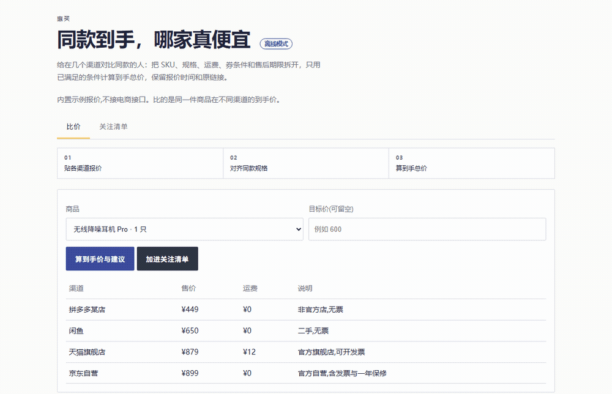
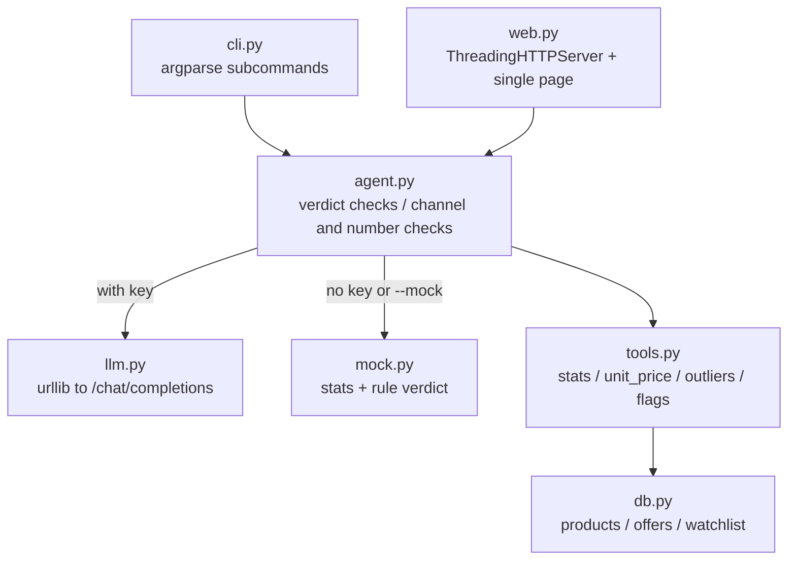

# Huimai 惠买

[](https://github.com/wushiyi105-jpg/huimai/actions)
[]()
[](./LICENSE)
[](https://codecov.io/gh/wushiyi105-jpg/huimai)



Pick a product and lay its offers from several channels side by side: landed price, unit price, which one is suspiciously low, whether to buy now — and put the one you want to wait for on a watchlist.

The hard part of price comparison is not scraping prices, it is the **landed price**. 879 with 12 shipping versus 899 with free shipping differs by eight yuan; 449 from a non-official seller without an invoice differs not in money but in after-sales support. Huimai adds shipping in, flags outliers, and gives a rule-based verdict — it never claims to authenticate goods, only tells you what to verify.

## Features

- **Landed-price sorting**: `price + shipping` is the comparable number; min, max, median and spread are computed locally.
- **Unit price**: estimates total quantity from specs (`3 包 × 60 片` → 180) and converts to price per piece or per 100g, so bulk packs cannot fake being cheaper.
- **Outlier flagging**: offers below 60% of the median landed price are listed separately, but not automatically declared fake — it could be a genuine subsidy or a trap.
- **Channel risk**: notes containing 临期 / 无票 / 非官方 / 二手 / 代购 / 清仓 raise a flag, and price risk is kept distinct from after-sales risk.
- **The model explains, never computes**: verdict (`值得买 / 再等等 / 换渠道 / 别买 / 没报价`), recommended channel, reasons and advice are model-written; but the channel must exist in the offer table and every number must come from the offers or local stats, otherwise the line is dropped.
- **Recommendation is shown apart from the lowest price**: the cheapest channel is often the most uncertain one, so "lowest landed" and "recommended" are listed separately.
- **Watchlist**: set a target price, and reaching it is marked; reaching it is a hint, not a purchase order.
- **Offline mode**: prices and stats still work, verdicts come from rules, with an explicit note that no authenticity check was made.
- **Two entry points**: CLI and web.

## Quick start

```bash
git clone https://github.com/wushiyi105-jpg/huimai.git
cd huimai
python -m huimai seed          # load built-in sample offers (4 products, 13 offers)
python -m huimai items
python -m huimai compare 1 --target 600
python -m huimai watch 1 --target 600
python -m huimai watchlist
```

With a model:

```bash
cp .env.example .env
# set LLM_API_KEY; defaults are https://api.deepseek.com + deepseek-flash
```

```bash
LLM_BASE_URL=https://open.bigmodel.cn/api/paas/v4 LLM_MODEL=glm-4.6 python -m huimai compare 1
```

Web UI:

```bash
python -m huimai web --port 8772
# http://127.0.0.1:8772
```

All offers live in `data/products-sample.json` as fixed sample prices; no e-commerce API is involved.

## Command reference

| Command | What it does |
| --- | --- |
| `seed` | Load built-in sample offers (same name overwrites) |
| `items` | Product list with lowest–highest landed price |
| `show <id\|name>` | Product detail and per-channel offers |
| `compare <id\|name> [--target N]` | Prices, risks, verdict |
| `offer <id\|name> --platform --price [--shipping] [--note]` | Add one offer manually |
| `watch <id\|name> [--target N]` | Add to watchlist |
| `watchlist` / `unwatch <id\|name>` | List / remove |
| `stats` / `web` | Stats / web |

Global flags: `--mock`, `--json`, `--model`, `--base-url`, `--api-key`, `--db`.

## How it works



Three trade-offs:

1. **Landed price is the only price.** Comparing list prices erases the difference between free and paid shipping; `stats` always sorts by `price + shipping`, so the "lowest" it reports is what you would actually pay.
2. **No authenticity claims.** This project has no channel licence data, serial number or invoice verification, so saying "this is fake" would be fabrication. It does only what it can: flag prices that are abnormally low and notes that mention 临期 / 无票 / 二手, leaving verification to you.
3. **Recommended is not the cheapest.** The cheapest offer is often the least certain; when the verdict is "switch channel" and the model's pick is itself an outlier, it is replaced by the next cheapest safe channel, and the output states what changed and why.

One SQLite file with `check_same_thread=False` + `threading.Lock`, default `data/huimai.db`, overridable via `HUIMAI_DB`.

## Layout

```
huimai/
├── huimai/
│   ├── __init__.py / __main__.py
│   ├── llm.py     # OpenAI-compatible client + .env loader
│   ├── db.py      # products / offers / watchlist
│   ├── tools.py   # price stats, unit price, outliers, channel risk
│   ├── mock.py    # offline stats and rule verdict
│   ├── agent.py   # verdict checks, channel and number checks
│   ├── cli.py     # command line
│   └── web.py     # web UI
├── data/products-sample.json
├── tests/test_huimai.py
├── assets/demo.gif
├── .github/workflows/test.yml
├── pyproject.toml
├── README.md / README.en.md
└── CHANGELOG.md / SECURITY.md / CODE_OF_CONDUCT.md / CONTRIBUTING.md
```

## Author

shiyi · GitHub [@wushiyi105-jpg](https://github.com/wushiyi105-jpg) · wushiyi105@gmail.com

MIT License, Copyright (c) 2026 wushiyi105-jpg
