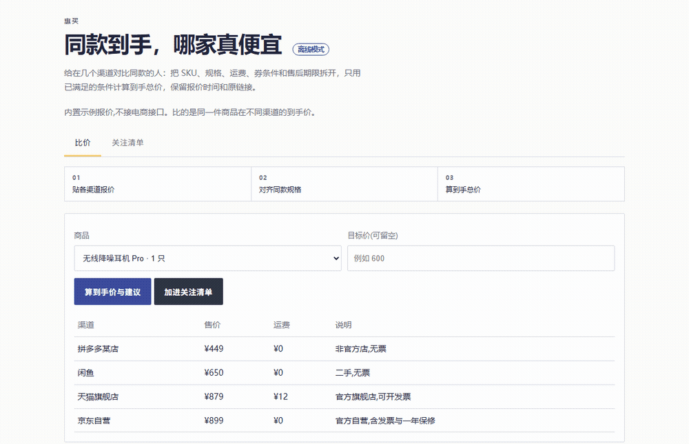
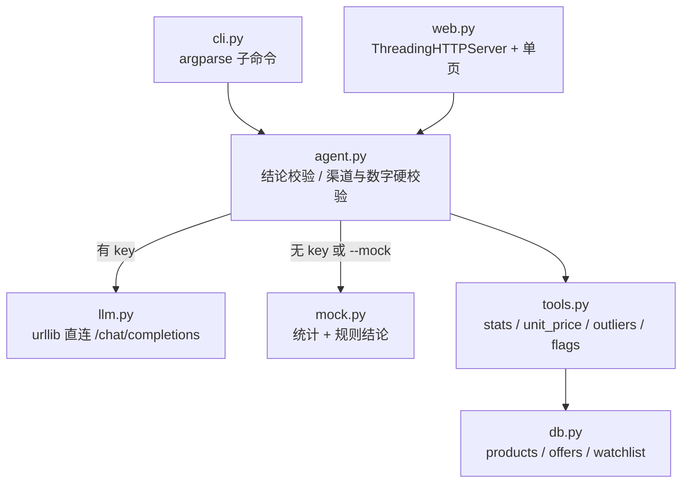

# 惠买 huimai

[](https://github.com/wushiyi105-jpg/huimai/actions)
[]()
[](./LICENSE)
[](https://codecov.io/gh/wushiyi105-jpg/huimai)



挑一个商品,把它在不同渠道的报价摆在一起:到手价、单位价、谁低得反常、该不该现在买,最后把想等的那个加进关注清单。

比价真正难的不是抓价格,是**到手价**。标价 879 运费 12,和标价 899 包邮,差的是 8 块钱;标价 449 非官方无票,差的不是钱,是售后。惠买把运费算进去,把异常低价单独标出来,再用规则给结论——不替你鉴定真伪,只提醒你哪里该核实。

## 功能特性

- **到手价排序**:`price + shipping` 才是可比的价格,最低/最高/中位/极差全部本地算。
- **单位价**:从规格里估总量(`3 包 × 60 片` → 180),折成元/片、元/100g,避免大包装看起来更便宜。
- **异常低价标注**:低于中位总价 60% 的报价单独列出,但不自动判假——它可能真是补贴,也可能是坑。
- **渠道风险**:备注里出现「临期 / 无票 / 非官方 / 二手 / 代购 / 清仓」即提示,并区分"价格风险"与"售后风险"。
- **模型只解释不算数**:结论(`值得买 / 再等等 / 换渠道 / 别买 / 没报价`)、推荐渠道、理由、建议都由模型写;但渠道名必须在报价表里,任何数字必须能在报价表或本地统计里找到,否则整条丢弃。
- **推荐与最低价分开显示**:最低价渠道可能正是风险最高的那家,所以"本地最低到手"和"推荐渠道"分开列,不混为一谈。
- **关注清单**:设目标价,到价标出来;到价只是提示,买之前仍要自己确认店铺与售后。
- **离线模式**:价格与统计照算,结论按规则给,明说不做真伪鉴定。
- **双入口**:CLI 与网页。

## 快速开始

```bash
git clone https://github.com/wushiyi105-jpg/huimai.git
cd huimai
python -m huimai seed          # 导入内置示例报价(4 个商品、13 条报价)
python -m huimai items
python -m huimai compare 1 --target 600
python -m huimai watch 1 --target 600
python -m huimai watchlist
```

接模型:

```bash
cp .env.example .env
# 填 LLM_API_KEY,默认 https://api.deepseek.com + deepseek-flash
```

```bash
LLM_BASE_URL=https://open.bigmodel.cn/api/paas/v4 LLM_MODEL=glm-4.6 python -m huimai compare 1
```

网页:

```bash
python -m huimai web --port 8772
# http://127.0.0.1:8772
```

报价全在 `data/products-sample.json` 里,是写死的示例价,不接任何电商接口。

Docker 运行(容器内用默认端口 8772):

```bash
docker build -t huimai .
docker run -p 8772:8772 huimai
```

## 命令参考

| 命令 | 作用 |
| --- | --- |
| `seed` | 导入内置示例报价(同名商品覆盖旧价) |
| `items` | 商品列表,带最低–最高到手价 |
| `show <id\|名称>` | 商品详情与各渠道报价 |
| `compare <id\|名称> [--target N]` | 比价、风险、结论 |
| `offer <id\|名称> --platform --price [--shipping] [--note]` | 手动补一条报价 |
| `watch <id\|名称> [--target N]` | 加入关注清单 |
| `watchlist` / `unwatch <id\|名称>` | 查看 / 移出 |
| `stats` / `web` | 统计 / Web |

全局开关 `--mock`、`--json`、`--model`、`--base-url`、`--api-key`、`--db`。

## 🤔 为什么不用通用大模型直接问

通用模型能说「这个价格挺划算」,但惠买补的是它做不到的三件事:

1. **到手价本地算** —— 商品价加运费才是到手价,单位价再按「3 包 × 60 片」换算,中位数、价差、异常低价全是本地算出来的;通用模型不会替你把运费加进去,也不会发现某家只有中位价的六成。
2. **便宜要有理由** —— 异常低价会被单独标出,同时列渠道风险:临期、无票、非官方旗舰、发货慢。结论只在这几个枚举里(值得买/再等等/换渠道/别买/没报价),不给一段模棱两可的话。
3. **清单留在本地** —— 关注清单和报价记录存在本地 SQLite;内置示例报价,不接电商 API,也不替你下单。
4. **离线能用** —— 比价、单位价、异常判断全是本地规则,没有 key 也照跑;模型只用来把结论讲顺一点。

## 🎯 适用场景

- **买大件前比一轮**:同一款耳机在四家平台的价格与运费录进去,先看到手价排序,再看最便宜那家为什么便宜。
- **看到「怎么这么便宜」**:某家比别家低一半,异常标记会提示临期或非官方,决定要不要为省这点钱承担风险。
- **盯一件商品**:加进关注清单,下次有报价再比,不用每次重新翻页面。

## 🗺 Roadmap

- **报价录入更省事**:支持一次粘贴多家报价,自动拆成渠道、价格、运费。
- **历史价格**:同一商品多次比价存成曲线,看是真降价还是先涨后降。
- **到手价含券含税**:把优惠券与税费纳入计算,而不是只看标价。
- **降价提醒**:关注清单里的商品低于目标价时提示一次。
- **对比表导出**:把一次比价导成 Markdown 表格,发给一起买的人。

## ❓ FAQ

**API key 从哪来?**
比价本身不需要 key;要模型润色结论时才用。默认接 DeepSeek(`https://api.deepseek.com`),填 `.env` 的 `LLM_API_KEY`。

**数据存在哪,会去电商平台抓价吗?**
不抓。报价是内置示例或你手动录入的,存在本地 SQLite;调模型时只发这一组报价,不发你的关注清单全貌。

**没有 key 能不能用?**
能,`compare` 是纯本地计算:到手价、单位价、异常标记、结论枚举都照出;只是结论的说法不如模型顺。

**怎么换模型?**
改 `LLM_BASE_URL`、`LLM_MODEL`、`LLM_API_KEY`,或用 `--model` 覆盖。

**为什么推荐的不是最便宜那家?**
因为最便宜那家被标成异常低价(临期/无票/非官方),结论会改成「换渠道」并推荐次低的安全渠道,而不是让你为了几十块踩坑。

## 工作原理



三处取舍:

1. **到手价才算价**。只比标价,包邮与不包邮的差别会被抹掉;`stats` 一律按 `price + shipping` 排序,给出的最低价才是你真要付的钱。
2. **不判真伪**。这个项目没有渠道资质、序列号、发票验真能力,说"这是假货"就是编。它只做能做的那部分:标出低得反常的、备注里有临期/无票/二手的,让你自己去核。
3. **推荐渠道不等于最低价渠道**。最低价常常来自最不确定的那家;结论是"换渠道"时,模型推荐的那家若本身是异常低价,会被换成次低的安全渠道,并在输出里说明改了什么、为什么改。

SQLite 单文件,`check_same_thread=False` + `threading.Lock`,默认 `data/huimai.db`,`HUIMAI_DB` 可改。

## 目录结构

```
huimai/
├── huimai/
│   ├── __init__.py / __main__.py
│   ├── llm.py     # OpenAI 兼容客户端 + .env 加载
│   ├── db.py      # products / offers / watchlist
│   ├── tools.py   # 价格统计、单位价、异常低价、渠道风险
│   ├── mock.py    # 离线统计与规则结论
│   ├── agent.py   # 结论校验、渠道与数字硬校验
│   ├── cli.py     # 命令行
│   └── web.py     # Web UI
├── data/products-sample.json
├── tests/test_huimai.py
├── assets/demo.gif
├── .github/workflows/test.yml
├── pyproject.toml
├── README.md / README.en.md
└── CHANGELOG.md / SECURITY.md / CODE_OF_CONDUCT.md / CONTRIBUTING.md
```

## 作者

罗之之 · 15071889700

MIT License,Copyright (c) 2026 wushiyi105-jpg
